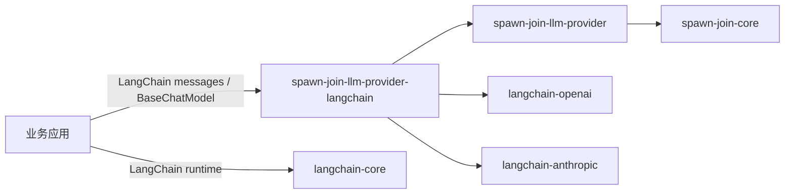

## 摘要

采用 LangChain-first 的 LLM runtime：应用直接使用 LangChain 消息和 `BaseChatModel`，
`spawn-join-llm-provider` 只保留 channel/协议选项/错误契约，
`spawn-join-llm-provider-langchain` 只提供模型工厂、选项映射和配置校验。
`ChannelConfig` 与 `ChatModelConfig` 继承共享 `EndpointConfig`，模型配置不依赖 channel。删除自定义消息、
内容块、工具、请求/响应、流式事件和 `LLMProvider` 设计；不实现 pool、路由、真实 HTTP
或 HTTP 连接池。

## 动机

旧设计（未合并 PR #16）在 LangChain 之外重复定义了消息、工具、请求/响应、流式事件和
Provider 协议，公共 API 面达到 54 个符号，而适配层只实际使用其中 41 个。仓库已经决定以
LangChain 作为消息和模型运行时；继续维护两套契约会增加映射、测试和升级成本。

本变更把重复层删除，只保留 LangChain 不提供、配置和运维确实需要的能力：channel 契约、
三种协议选项、协议选项校验和少量稳定错误。

## Slice / Stack

- Slice 与目标：S0 默认 Slice 策略；S1 core 契约；S2 LangChain 工厂；S3 验证与证据
- Base 分支：`main`（`353af49`）
- 依赖：S0 → S1 → S2 → S3
- 合并顺序 / 方式：按 S0–S3 顺序 squash 到 `main`；当前分支包含全部实现提交
- 不包含在本层：真实 channel HTTP、Provider 请求、pool、路由、健康选路、HTTP 连接池、
  包重命名、PR #16 合并
- 回滚：按提交逆序 revert；没有持久化数据或外部资源需要迁移

## 变更类型

- [x] 新功能
- [x] 重构或简化
- [x] 文档或治理

## 当前设计（变更前）

- 入口或组件：两个 LLM 包只有命名空间骨架；旧实现留在未合并 PR #16
- 归属与依赖方向：`spawn-join-llm-provider` 计划承载自定义消息/Provider；适配层负责
  LangChain 映射
- 当前约束与不变量：应用尚未直接依赖 LangChain 消息；没有已发布外部消费者

## 变更内容

| 位置 | 变更 | 原因 |
| --- | --- | --- |
| `packages/core/llm-provider/src/spawn_join_llm_provider/` | 新增 `options.py`、`endpoints.py`、`channels.py`、`errors.py`，重写 `__init__.py` | 保留 LangChain 不提供的协议选项、共享 endpoint、channel 和稳定错误 |
| `packages/core/llm-provider/tests/` | 新增选项、channel、错误、公共 API 测试 | 覆盖边界、异常和精确公共面 |
| `packages/infra/llm-provider-langchain/src/spawn_join_llm_provider_langchain/` | 新增 `config.py`、`factory.py`，重写 `__init__.py`，删除空 `providers/` | `ChatModelConfig` 继承 `EndpointConfig`，直接创建 `BaseChatModel`；不依赖 channel、不保留 Provider 包装 |
| `packages/infra/llm-provider-langchain/tests/` | 新增工厂、校验、公共 API 测试 | 覆盖三协议、选项映射、密钥掩码和失败路径 |
| `docs/architecture/package-boundaries.md`、`AGENTS.md` | 更新两包职责和依赖方向 | 让文档匹配实现 |
| `docs/decisions/llm-provider/0006-*`、`docs/decisions/engineering/0007-*`、索引 | 新增/接受 ADR | 记录 LangChain-first 和默认 Slice 决策 |
| `.specify/extensions/delivery/delivery-config.yml` | `pr_slicing: "auto"` | 默认启用 Slice 交付 |
| `.specify/delivery/008-*` | exploration、decision-context、slices、evidence、receipts、task verdicts | 记录范围、切片、验证和残余风险 |

## 影响

| 维度 | 影响 | 证据 |
| --- | --- | --- |
| 公共 API、命令、配置 | core 精确导出 21 个符号；adapter 精确导出 `ChatModelConfig`、`create_chat_model`；`ChatModelConfig` 不依赖 `ChannelConfig`；协议包不依赖 LangChain | `test_public_api.py`、`test_package.py` |
| 持久化或迁移 | N/A；没有持久化数据或 schema | — |
| 兼容性与升级路径 | 两个包仍为 `0.1.0`；旧实现未合并，没有已发布调用方需要迁移 | `spec.md`、ADR-0006 |
| 安全与权限 | `credential_ref` 只保存引用；API key 只以 `SecretStr` 进入 LangChain；endpoint 拒绝内嵌凭据；channel name 拒绝控制字符 | `test_factory.py`、`test_channels.py` |
| 性能与资源 | 无运行时性能目标；只做离线模型构造和 fake channel；没有网络、pool 或路由 | quickstart、evidence |
| 依赖与供应链 | protocol 包只依赖 core；adapter 增加 `langchain-openai`、`langchain-anthropic`、`pydantic` | `pyproject.toml`、`uv.lock` |

## 设计

## 架构决策

- [x] 已链接相关 ADR，并与 HEAD 的实现一致。
- ADR-0006：LangChain-first LLM runtime，`Accepted`
- ADR-0007：默认启用 Slice 交付，`Accepted`
- ADR-0005：只存在于未合并 PR #16，不在 `main`；本变更不修改不存在的文件

## 行为与验收

| 需求 | 结果 | 证据 |
| --- | --- | --- |
| US1：三协议模型工厂 | Chat Completions/Responses 返回 `ChatOpenAI`，Anthropic 返回 `ChatAnthropic`；`ChatModelConfig` 直接携带 protocol/endpoint/timeout，`use_responses_api`、`max_retries` 显式设置 | `test_factory.py`、quickstart 构造结果 |
| US2：channel 契约 | `ChannelConfig` 继承 `EndpointConfig`，增加 name/credential_ref；ping 和 list_models 的全部结果可区分 | `test_channels.py` |
| US3：精简公共 API | core 21 个导出、adapter 2 个导出；无 Message/Provider/map_options/bind_options | `test_public_api.py`、`test_package.py` |
| FR-001–FR-019 / SC-001–SC-008 | 已实现或明确排除；无 pool/HTTP/路由/包重命名 | `tasks.md`、evidence、final review |

## 验证

| 检查 | 结果 | 证据 |
| --- | --- | --- |
| 构建 | pass | `scripts/quality.ps1` 全量四包隔离构建与安装 |
| 测试 | pass | core 129 tests；adapter 38 tests |
| 规范与 Spec 审查 | pass | final independent review at `d6cdc37`；convergence 无缺口 |
| ADR 一致性 | pass | ADR-0006/0007 Accepted；索引与实现一致 |
| 变更范围的简化检查 | pass | 删除重复消息/Provider 层；无新增 pool/路由 |
| 门禁回归 | pass | `test-quality` 9、`test-governance` 23、`test-static` 3 |
| quickstart | pass | 20/2 导出；三模型构造；API key 掩码 |
| 文档/治理/静态 | pass | `quality.ps1` 全量退出 0；本机 `specs/007` 临时移出并恢复 |

## 文档

- [x] 源文档已更新。
- [x] 生成文档已同步（README、package boundaries、AGENTS、ADR、quality gates）。
- [ ] 不需要文档变更。

## 回滚

按提交逆序 revert：
`4b9058f`（证据/ADR 状态）→ `d6cdc37`（最终评审修复）→ `4598eb5`（S2）→ `60de8a0`（S1）
→ `a524aaf`（S0）。没有持久化数据或外部资源需要清理。

## AI 辅助

- [ ] 未使用 AI 辅助。
- [x] 使用了 AI 辅助，且每一行变更都已审阅和验证。

## 评审说明

- 最终独立评审在 `d6cdc37` 通过；`4b9058f` 只更新 Delivery 证据、receipts 和 ADR 状态。
- 本地全量质量门通过；远端 CI、push、PR 创建和 merge 未执行，需要单独授权。
- 真实 channel HTTP、Provider 请求、streaming/tool execution 未执行；这些能力不在本 PR 范围。
- PR #16 保持 open、未合并；本 PR 从 `main` 重新实现。

## 检查清单

- [x] 验收条件已覆盖。
- [x] 阻断性评审问题已解决。
- [x] ADR 与 HEAD 的实现一致。
- [x] 已附相关验证证据。
- [x] 外发 diff 与已审阅范围一致。
