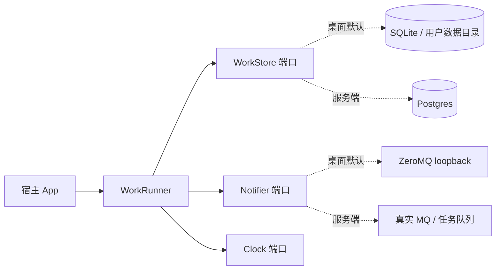

# ADR-0016: 可复用运行时包采用桌面优先、服务端可替换策略

- Status: Accepted
- Date: 2026-11-21
- Domain: engineering / packaging
- Classification: 约束可复用运行时与基础设施包的默认实现、公共契约和部署档位，属于跨包的工程与交付策略，不归单一业务包。
- Decision owner: 仓库维护者
- Accepted by / date: 仓库维护者 / 2026-11-26
- Depends on: [ADR-0010](../agent/0010-deepagents-product-boundary.md)、[ADR-0015](../agent/0015-personal-assistant-host-boundary.md)
- Related: [包边界](../../architecture/package-boundaries.md)、[ADR-0011](0011-common-helper-package.md)
- Supersedes: 无
- Superseded by: 无

## Context and drivers

SpawnJoin 计划同时支持两种产品形态：

1. **桌面产品**：单用户、本机运行，不要求用户安装数据库或消息中间件；
2. **SaaS 产品**：多租户、服务端部署、需要水平扩展的 worker。

当前长任务生命周期能力位于 `packages/apps/personal-assistant`：`WorkStore` 直接使用
stdlib `sqlite3`，`Scheduler.run_due` 只执行一个周期，CLI `run` 结束后退出
（`cli.py:302`）；不存在常驻循环、租约、心跳或失败重试。`spawn-join-agent-deepagents`
则明确不实现数据库与后台调度（ADR-0010；`packages/infra/agent-deepagents/README.md:680-681`）。

计划中的 `spawn-join-agent-work` 需要同时满足两种形态，因此必须先固定一条部署策略：
**默认实现面向桌面，公共契约不得阻断服务端替换**。若不固定，常见后果是把 SQLite 单写者、
单进程假设或本地路径写进公共 API，未来 SaaS 化时只能破坏性演进。

已知约束与事实：

- `AppConfig.data_dir` 目前必须由调用方显式提供（`packages/apps/personal-assistant/src/spawn_join_personal_assistant/config.py:64-68`），尚无平台默认数据目录；
- `personal-assistant` 声明一个数据目录同一时刻只允许一个宿主进程（该包 `README.md:929-930`）；
- Constitution III 要求能力在至少两处稳定复用后才提升；当前非测试的真实消费者只有
  `personal-assistant` 一个，因此本条策略记录的是维护者的前瞻性决策，不自行创建包；
- 服务端档位不能使用 SQLite 承担多 worker 领取。

未知项（不影响本决策，但影响后续 Feature 范围）：SaaS 上线时间、租户隔离模型（共享库
+ namespace 还是独立库）、是否需要 Temporal 一类外部持久执行平台。

## Options considered

1. **把约束写进 Constitution**：原则层级最高，但产品部署形态会随商业方向变化，导致宪法
   频繁修订；且它可由现有“副作用拥有者、依赖单向、抽象需真实复用”原则推导，不是新原则。拒绝。
2. **把工作项生命周期放进 `spawn-join-agent-deepagents`**：新 app 可直接复用，但会让装配包
   拥有数据库 schema、迁移和后台调度，直接违反 ADR-0010 的边界。拒绝。
3. **独立 infra 包 + 桌面默认适配器 + 服务端可选适配器**（采用）：持久化适配器有明确
   拥有者，装配包保持职责单一，未来 SaaS 只需替换存储与队列适配器。
4. **只支持桌面或只支持 SaaS**：与产品计划冲突；且先做单形态会在另一形态到来时推翻契约。
   拒绝。
5. **立即引入 Temporal + Celery**：Temporal 是持久执行引擎，Celery 是 broker 任务队列，
   两者职责重叠；同时引入会产生两套重试、状态与运维面，且对桌面安装是不可接受的依赖。
   拒绝作为默认；Temporal 保留为未来服务端档位的可选引擎，Celery 不采用。

## Decision

对**拥有持久化状态、队列/后台执行或自身常驻进程/守护循环的可复用运行时/基础设施包**
（首个目标为 `spawn-join-agent-work`，本条不自行创建该包；纯协议、类型或辅助包不适用；
调用方拥有的资源装配，如 ADR-0010 的 backend/checkpointer，不属于本条的进程生命周期）
采用以下策略：

1. **桌面档为默认实现**：必须能在无外部服务的桌面环境运行——单用户、平台用户数据目录下的
   SQLite、本地唤醒与轮询兜底；不要求安装数据库、broker 或服务端。
2. **公共契约必须可移植**：不得固化桌面专属语义（单机绝对路径、单进程假设、单租户假设）。
   存储、唤醒、时间源通过端口注入；claim 逻辑只依赖标准 SQL 子集，便于 Postgres 等实现。
3. **任务真相与唤醒分离**：持久存储是任务真相；消息队列只负责降低领取延迟。即使消息丢失，
   轮询也能完成任务领取，不允许把 broker 当作唯一真相来源。
4. **服务端档位显式可选**：SaaS 使用 Postgres 等支持并发领取的存储，禁止部署 SQLite；
   队列可替换为真实 MQ 或服务端任务队列。SaaS 专属能力（认证、租户管理、配额、计费、
   RLS 策略）由宿主与适配器提供，不进入默认实现。
5. **预留最小接缝**：工作项携带 `namespace`（默认 `"default"`），用于未来租户隔离与公平调度；
   本条不实现租户功能，也不把认证放进复用包。
6. **外部执行引擎不作为默认**：Temporal 仅作为未来服务端档位的可选替换记录；Celery 不采用；
   ZeroMQ 仅作为桌面档默认唤醒适配器，可替换为其他 MQ。
7. **依赖与安装分层**：基础安装保持最小；桌面档通过显式 extra 启用 ZeroMQ，服务端档通过
   对应 extra 启用 Postgres/MQ 客户端。具体打包方式由 Feature 计划确定，但不改变上述行为。

明确不处理的相邻问题：多租户实现、认证授权、计费、Web UI、MCP Server、远程沙箱、Postgres
迁移工具、Temporal 集成实现。

## Key design and diagrams

目标档位（桌面档已实现；服务端档为可替换目标）：

不变量：

- 入队事务提交后才发布唤醒信号；worker 必须回库原子 claim；
- 消息只携带工作项标识，不携带业务正文；
- 租约带 fencing token，过期 worker 的写回必须被拒绝；
- 重试为 at-least-once；执行副作用幂等由宿主承诺，复用包不声称 exactly-once；
- 时间语义通过 `Clock` 注入；多机租约判定优先使用数据库时间。

数据位置策略：

- 桌面档使用平台用户数据目录（如 Windows `%LOCALAPPDATA%`、macOS Application Support、
  Linux `~/.local/share`），并提供显式覆盖入口；
- 既有数据目录迁移必须显式执行（复制 + 备份），不得静默搬移；
- SaaS 档由连接配置提供数据库地址，不读取桌面路径。

## Consequences and migration

收益：

- 桌面安装开箱即用，不引入服务端依赖；
- SaaS 化只需替换存储/队列适配器，公共契约不用推翻；
- 持久化与调度的拥有者明确，`agent-deepagents` 继续只承担装配职责。

成本与限制：

- 需要维护两套适配器契约与一致的契约测试；
- 桌面档默认引入 ZeroMQ 客户端依赖，需纳入供应链与 CI 评估；
- 公共 schema/协议需要版本化与迁移策略；
- SQLite 单写者限制仍然存在，SaaS 必须切换存储；
- 本决策不解决多租户语义，只预留 `namespace`。

迁移路径（已完成）：

- `personal-assistant` 的工作项存储与调度已迁移到 `spawn-join-agent-work`，行为由现有测试守卫；
  迁移随 PR #93–#98 交付，证据见 `agent-work-main-integration-20261123`。
- 迁移落地时已同步修订 [ADR-0015](../agent/0015-personal-assistant-host-boundary.md) §Decision
  第 1 条（work 存储与调度所有权）；宿主保留 HITL 兼容层，后续是否收敛由宿主包的兼容性决策决定。
- 桌面数据目录解析新增默认值，但保留显式配置与迁移路径。
- 服务端适配器在真实 SaaS 需求出现后实现，不在第一批预建空模块。

重新评估触发条件：

- SaaS 产品进入实现或出现真实多租户/多机 worker 需求；
- 需要引入 Temporal 或其他持久执行平台；
- ZeroMQ 被替换为其他 MQ，或 pyzmq 供应链/平台支持出现问题；
- 出现第二个真实复用消费者，或复用假设被证伪。

## Verification and implementation status

- 本条为 **Accepted** 决策（2026-11-26）。桌面默认档与契约可移植约束已由
  `spawn-join-agent-work` 实现：SQLite/内存存储、ZeroMQ 唤醒、runner/租约/恢复；
  `personal-assistant` 已迁移到该包（PR #93–#98）。
- 初始变更只包含 ADR、决策索引与 AGENTS 约束；实现与迁移由后续 Feature 完成，证据见
  `.specify/delivery/agent-work-main-integration-20261123/evidence.md` 与
  `.specify/delivery/agent-work-desktop-20261122/slices.md`。
- 服务端存储/MQ 适配器、多租户、Temporal 集成仍未实现，按本 ADR 的重新评估条件另行
  决策；接受本策略不表示这些能力已完成。

## Revision history

- 2026-11-21：提出桌面优先、服务端可替换的可复用运行时包策略，记录默认档位、契约可移植性、
  namespace 接缝、依赖分层与 Temporal/Celery 定位；状态为 Proposed。
- 2026-11-26：维护者接受本策略；更新实现状态（`spawn-join-agent-work` 已交付、
  `personal-assistant` 已迁移），并明确服务端适配器仍未实现。
