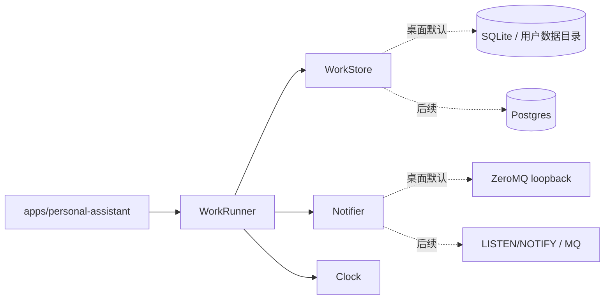

# ADR-0017: 桌面长任务运行时的包边界与生命周期语义

- Status: Proposed
- Date: 2026-11-22
- Domain: engineering / runtime
- Classification: 约束新 `spawn-join-agent-work` Distribution 的归属、公共契约、状态机、存储/唤醒适配器与迁移路径，属于跨包运行时边界决策。
- Decision owner: 仓库维护者
- Accepted by / date: 未批准
- Depends on: [ADR-0010](../agent/0010-deepagents-product-boundary.md)、[ADR-0015](../agent/0015-personal-assistant-host-boundary.md)、[ADR-0016](0016-desktop-first-service-ready-packages.md)
- Related: [包边界](../../architecture/package-boundaries.md)、[ADR-0016](0016-desktop-first-service-ready-packages.md)
- Supersedes: 无
- Superseded by: 无

## Context and drivers

`personal-assistant` 现有工作项生命周期：`WorkStore` 直接使用 stdlib `sqlite3`，`Scheduler.run_due`
只执行一个周期，CLI `run` 结束后退出；没有常驻循环、租约/心跳、失败退避或跨进程 worker。
`spawn-join-agent-deepagents` 明确不实现数据库与后台调度（ADR-0010），因此长任务生命周期既不能
留在装配包，也不适合继续由单个 app 私有实现。

用户已确认：

- 后续会出现类似 `personal-assistant` 的 app，需要复用长任务能力；
- 桌面默认使用 SQLite + ZeroMQ（保留 ZMQ），SaaS 后续使用 Postgres + `LISTEN/NOTIFY` 或 MQ；
- Phase 1 只做桌面闭环，同时定义可替换接口；
- 用内存实现作为第二实现验证契约，避免 SQLite 专属抽象。

ADR-0016 已记录“桌面优先、服务端可替换”的跨包策略与单消费者例外；本 ADR 固定具体包边界与
生命周期语义，供 Plan/Tasks/实现使用。

## Options considered

1. **放进 `spawn-join-agent-deepagents`**：复用方便，但违反 ADR-0010 的“不实现数据库/后台调度”，
   并会让装配包拥有 schema/迁移/租约。拒绝。
2. **继续留在 `personal-assistant`，只抽内部接口**：改动最小，但无法满足后续 app 复用，且 app
   继续承担 infra 能力。拒绝。
3. **新建 `spawn-join-agent-work` infra 包，桌面默认 SQLite+ZMQ，端口化存储/通知**（采用）：
   持久化副作用有明确拥有者；装配包零改动；后续 SaaS 只换适配器。
4. **新包同时实现 Postgres/MQ**：无真实 SaaS 需求/环境，增加运维与契约面。拒绝（后续切片）。
5. **直接使用 Temporal/Celery**：引擎/平台级替换，对桌面过重；Phase 1 不采用。

## Decision

1. **包与依赖**：新增 `spawn-join-agent-work`（路径 `packages/infra/agent-work`，import
   `spawn_join_agent_work`），作为独立 Distribution。它不依赖 LangChain/DeepAgents/模型包；
   `apps` 组合 `agent-work` 与 `agent-deepagents`。
2. **端口**：`WorkStore`、`Notifier`、`Clock`、`WorkExecutor` 为公共契约；`WorkRunner` 负责
   claim → 执行 → 续租 → finalize。存储/通知实现通过构造注入，不做动态插件发现。
3. **桌面默认适配器**：`SqliteWorkStore`（WAL、`BEGIN IMMEDIATE` 原子 claim、租约、重试、
   保留）+ `InMemoryWorkStore`（契约测试第二实现）+ `ZmqNotifier`（PUB/SUB，仅唤醒）。
4. **真相与唤醒分离**：Store 是任务真相；消息只带 `work_id`/queue；通知丢失由轮询兜底；
   at-least-once；不承诺 exactly-once 副作用。
5. **状态机**：`queued/running/waiting/completed/failed/dead/cancelled`；`waiting` 不被 runner
   自动领取，宿主 `resume` 回 `queued`；所有写回校验 lease token（fencing）。
6. **服务端档位**：Postgres + `LISTEN/NOTIFY` 或 MQ 作为后续适配器；服务端禁用 SQLite；本 ADR
   不实现这些适配器，也不把 MQ 作为真相层。
7. **迁移**：`personal-assistant` 迁移到 `agent-work`，行为保持等价；迁移切片同时修订
   ADR-0015 §Decision 第 1 条的 work 所有权。产品尚未上线，**不提供旧数据库迁移**；首次启动
   直接创建当前 schema。
8. **依赖分层**：Phase 1 基础依赖 `pyzmq`（桌面默认）；SQLite 为 stdlib；`[postgres]`/`[mq]`
   extras 留到后续，不创建空模块。

明确不处理的相邻问题：多租户/认证/配额/计费、Web UI、MCP Server、远程沙箱、记忆、Temporal
集成、Postgres/MQ 实现、跨机部署。

## Key design and diagrams

不变量：

- 入队提交后才发布唤醒；worker 必须回库 claim；
- 写回必须匹配 lease token；过期执行者写回被拒；
- 重试按策略退避；耗尽进入 `dead`，不可重试进入 `failed`；
- 关闭停止 claim、释放在飞租约、幂等；
- 公共 API 不暴露 SQL/连接/文件路径。

## Consequences and migration

收益：

- 长任务能力有独立可复用边界；后续 app 不需要复制 WorkStore/Scheduler；
- 桌面默认离线可用；SaaS 只替换存储/通知适配器；
- `agent-deepagents` 保持装配职责；依赖方向清晰。

成本与限制：

- 新增第 9 个 Distribution：锁文件、Profile、CI 矩阵、双语 README、包边界文档；
- `pyzmq` 成为基础依赖，需纳入供应链/打包体积评估；
- 引入 3 个切片与独立评审成本；
- SQLite 单写者限制仍在，多机不支持；
- 公共契约需要版本化与契约测试维护。

迁移与重新评估：

- 迁移以现有宿主测试为回归基线；产品未上线，不做旧库迁移；
- ADR-0015 在迁移落地时同步修订；在此之前其所有权描述仍然有效；
- 触发重新评估：第二个真实消费者出现、SaaS 上线、需要多机/高吞吐、Temporal 评估、
  pyzmq 供应链问题。

## Verification and implementation status

- 本 ADR 为 **Proposed**；实现尚未开始。
- 计划验证：新包与宿主的质量门、SQLite/InMemory 契约测试、ZMQ 丢消息/重复消息、崩溃/租约/
  fencing/退避/关闭、CI 9×3、docs/governance。
- 实际命令与结果将记录在 Delivery evidence；本 ADR 不把计划写成已验证。
- `Accepted` 需维护者在 reviewed HEAD 上批准；实现与证据另附。

## Revision history

- 2026-11-22：提出 `spawn-join-agent-work` 包边界、端口、桌面默认适配器、状态机与迁移路径；
  状态为 Proposed。
